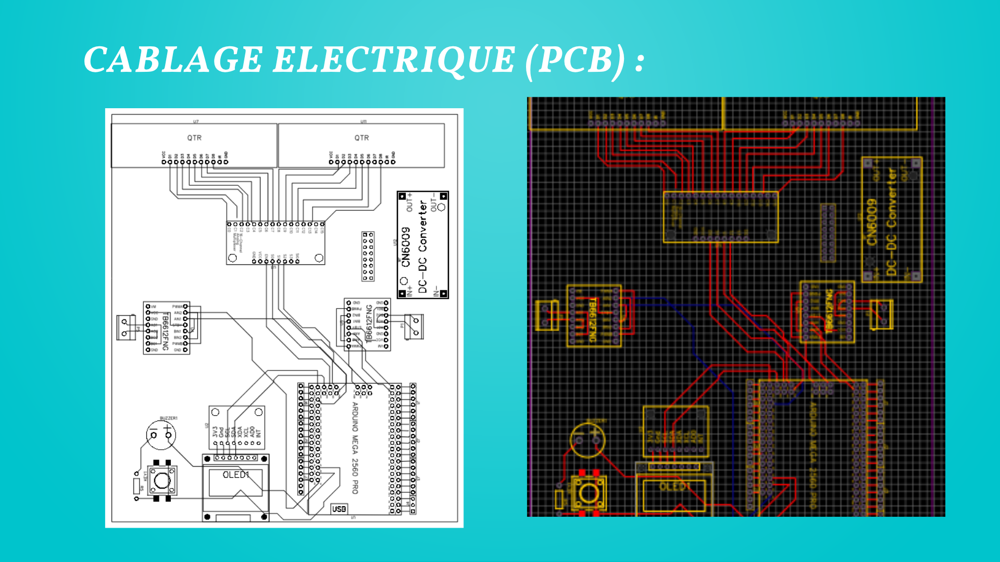
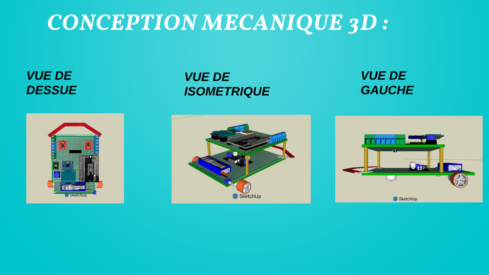
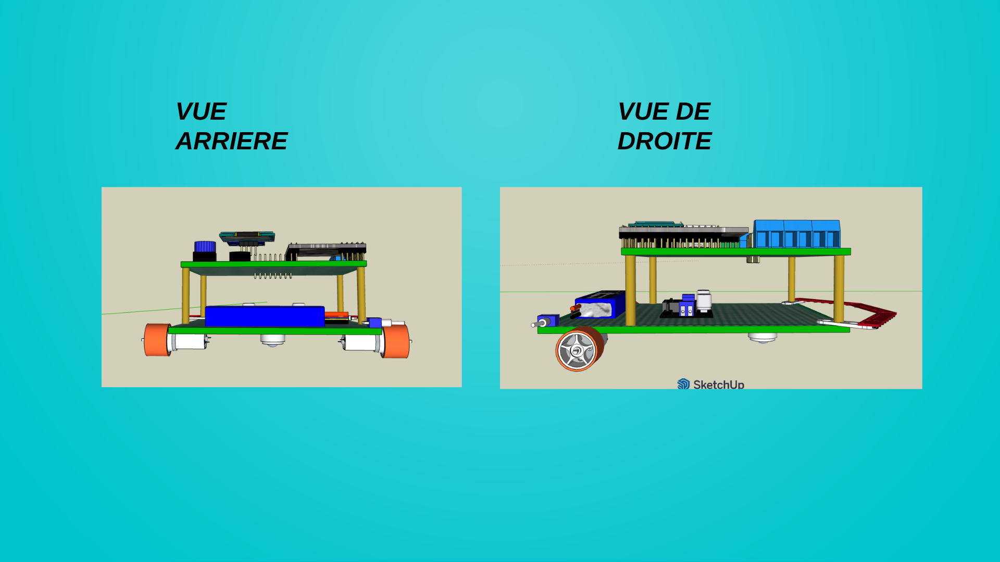

# Custom Line Follower Robot

A competition line follower robot designed and built from scratch: electrical design in Fritzing (wiring and PCB), 3D mechanical design in SketchUp, real-time firmware in C++ on an **Arduino Mega 2560 Pro**, and an Android app for voice control.

The platform is generic. The core (line control, speed presets, encoder moves, turns, display, Bluetooth) stays the same, and each competition gets its own **mission program** written on top of it. This repository includes the program used at **ENSTAB** as an example.

🏆 **1st place** at the ENSTAB, ENIM and ENIG robotics competitions (2025).

<!-- TODO: add a photo of the robot -->
<!--  -->

## Videos

<!-- TODO: paste the two links (YouTube, or drag the .mp4 into the README on github.com if under 10 MB) -->
| Competition run (ENSTAB) | Voice control |
|---|---|
| <!-- [▶️ Watch](https://youtu.be/...) --> *coming soon* | <!-- [▶️ Watch](https://youtu.be/...) --> *coming soon* |

## Features

- **PD line following** on a 16-sensor XLINE board, with black-line and white-line modes
- **Speed presets** tuned on the track and switched between sections (straights, curves, slow zones)
- **Encoder-based moves and turns**: encoders on interrupts, with a PID correction that keeps both wheels in sync
- **Mission programs**: each track section is a short sequence of line following and sensor-triggered manoeuvres, so a new competition only needs new mission files
- **Voice control** from an Android app (Kodular) over Bluetooth (HC-05)
- **On-robot feedback**: OLED screen (live sensor bars, messages), RGB LED and buzzer to validate each step of the logic on the track
- **Own hardware design**: Fritzing wiring diagram and PCB layout, two-level chassis designed in SketchUp

## Hardware

| Component | Role |
|---|---|
| Arduino Mega 2560 Pro (ATmega2560) | Main controller |
| XLINE 16 Line Sensor Board, Digital V2 | Line detection |
| 2 × ProFast 12 V DC motors + 2 wheels, 1 caster wheel | Propulsion |
| 2 × TB6612FNG | Motor drivers |
| OLED 0.96" 128×64 (I2C) | Live sensor bars and messages |
| RGB LED, buzzer, push button | Feedback and start / calibration |
| HC-05 | Bluetooth link to the voice control app |
| LiPo 11.1 V 650 mAh (3S) | Battery |
| 2 × LM2596 buck regulators | Power for the logic and the motors |
| 2 × toggle switches, 4 × 100 Ω resistors | Power switching, LED resistors |

## Electrical and mechanical design

**PCB layout (Fritzing)**: the two 8-sensor bars feed a 16-channel multiplexer, so all 16 line sensors are read through a single analog pin. The board also carries the two TB6612FNG drivers, the DC-DC converter, the OLED, the IMU and the start button.



**3D mechanical design (SketchUp)**: two-level chassis, with the battery, power and motors on the lower deck and the controller, drivers and display on the upper deck.




<!-- TODO: add the Fritzing wiring diagram (slide 5) -->
<!--  -->

## Architecture

```
INPUTS                       ARDUINO MEGA 2560 PRO                    OUTPUTS
16-sensor XLINE ──┐   ┌──────────────────────────────────┐
encoders        ──┼──►│ core: PD line control,           │──► 2 × TB6612FNG ──► 2 DC motors
push button     ──┘   │ speed presets, encoder turns     │──► OLED, RGB LED, buzzer
                      │                                  │
                      │ mission program (per competition)│
                      │ voice / Bluetooth commands       │
                      └────────────────▲─────────────────┘
                                       │ HC-05 Bluetooth
                    Android app (Kodular): speech → one-letter command
```

## Run modes

Set `USE_BLUETOOTH` at the top of [`main_code.ino`](firmware/main_code/main_code.ino):

| Value | Mode |
|---|---|
| `0` | Competition: runs the mission program, then waits for the button to run again |
| `1` | Voice control from the Android app |

## How the line control works

```
line sensors ──► line position ──► error = centre − position
                                          │
                                          ▼
                    correction = Kp·error + Kd·(error − last error)
                                          │
         left = base − correction, right = base + correction
                                          │
                                          ▼
                              TB6612FNG ──► 2 DC motors
```

Gains and speeds change along the track (from [`Line_Follower.ino`](firmware/main_code/Line_Follower.ino)):

| Preset | Kp | Kd | Max speed (0-255) | Used for |
|---|---|---|---|---|
| `strate_config` | 0.023 | 0.15 | 240 | fast straights |
| `maxspeed_config` | 0.04 | 0.25 | 230 | fast sections |
| `mediumspeed_config` | 0.038 | 0.2 | 140 | default |
| `mediumspeed_config_pro` | 0.038 | 0.2 | 120 | tight turn sequences |
| `minspeed_config` / `strate_configmin` | 0.027 / 0.015 | 0.15 / 0.12 | 130 | slow, precise zones |

## Example: the ENSTAB mission program

The ENSTAB track had six themed sections, run in this order:

| # | Mission | File |
|---|---|---|
| 1 | Mexic: fast straight, then slows down for the checkerboard | `Mission_1_Mexic.ino` |
| 2 | Penalty: manoeuvres around the 18-metre box | `Mission_2_Penalty.ino` |
| 3 | Australia: three loops with sharp turns | `Mission_3_Australia.ino` |
| 4 | Holland: a long sequence of turns and line recoveries | `Mission_4_Holland.ino` |
| 5 | Modric: speed changes, crossing a gap, then a turn | `Mission_5_Modric.ino` |
| 6 | France: white line on a black background, then back to black | `Mission_6_France.ino` |

The ENSTAB program reads 14 of the 16 sensors (`SENSORCOUNT` in `main_code.ino`).

**Adapting to another competition:** replace the `Mission_*.ino` files with the new track's sections and update the mission sequence in `loop()`. The rest of the firmware stays the same.

## Voice control app

An Android app made with **Kodular**: it listens to a spoken command, turns it into a one-letter command and sends it to the robot over Bluetooth.

<!-- TODO: add a screenshot of the app -->
<!--  -->

- Install: download [`Flash-Voice-Control.apk`](app/Flash-Voice-Control.apk) on an Android phone and allow installs from unknown sources.
- Pair the phone with the HC-05 (default PIN 1234 or 0000), open the app and connect.

| Command | Action |
|---|---|
| `F` | Forward |
| `B` | Backward |
| `R` | Turn right |
| `L` | Turn left |
| `D` | Dance (turn right for 300 ms) |
| `S` | Stop |

## Pin map (ENSTAB program)

| Part | Pins (Mega 2560 Pro) |
|---|---|
| TB6612FNG motor drivers | AIN1 14, AIN2 4, PWMA 6 · BIN1 12, BIN2 10, PWMB 8 |
| Encoders | Motor 1: A 2, B 3 · Motor 2: A 18, B 19 |
| Line sensors | A0 |
| SSD1306 OLED (I2C) | address 0x3C |
| MPU6050 gyroscope (I2C) | optional, disabled in the ENSTAB program |
| RGB LED | R 39, G 37, B 35 |
| Buzzer | 41 |
| Push button | 33 |
| HC-05 Bluetooth | module TX → 13, module RX → 11 (SoftwareSerial) |

## Startup

1. The screen shows **Calib QTR**: press and release the button.
2. Sweep the sensor bar over the line and the background while the blue LED is on.
3. The screen shows live sensor bars: press the button to start.

## Repository layout

```
firmware/main_code/   Arduino firmware (open main_code.ino in the Arduino IDE)
app/                  Android voice control app (.apk) built with Kodular
docs/design/          wiring diagram, PCB layout, 3D design
docs/images/          photos and screenshots
```

| Firmware file | Contents |
|---|---|
| `main_code.ino` | Pins, globals, `setup()`, `loop()` with the run modes, startup sequence |
| `Line_Follower.ino` | Speed presets, `PidLine()` variants, calibration |
| `Encoder.ino` | Encoder interrupts, synchronised straight moves |
| `Utils.ino` | Motors, turns, LED, buzzer, OLED, sensor helpers |
| `Bluetooth.ino` | Voice / Bluetooth commands |
| `Gyro.ino` | MPU6050 angle reading and gyro PID moves |
| `Mission_*.ino` | Competition-specific mission program (ENSTAB example) |

## Build and flash

1. Install the [Arduino IDE](https://www.arduino.cc/en/software).
2. Install these libraries from the Library Manager: Adafruit SSD1306, Adafruit GFX, SparkFun TB6612FNG, QTRSensors (Pololu), I2Cdevlib MPU6050.
3. Open `firmware/main_code/main_code.ino`, select **Tools → Board → Arduino Mega or Mega 2560** (processor ATmega2560), and upload.

## Tech

C++, Arduino Mega 2560 Pro (ATmega2560), PD control, line sensor array, encoders and interrupts, I2C (OLED, MPU6050), HC-05 Bluetooth, Kodular, Fritzing (wiring and PCB), SketchUp, soldering
